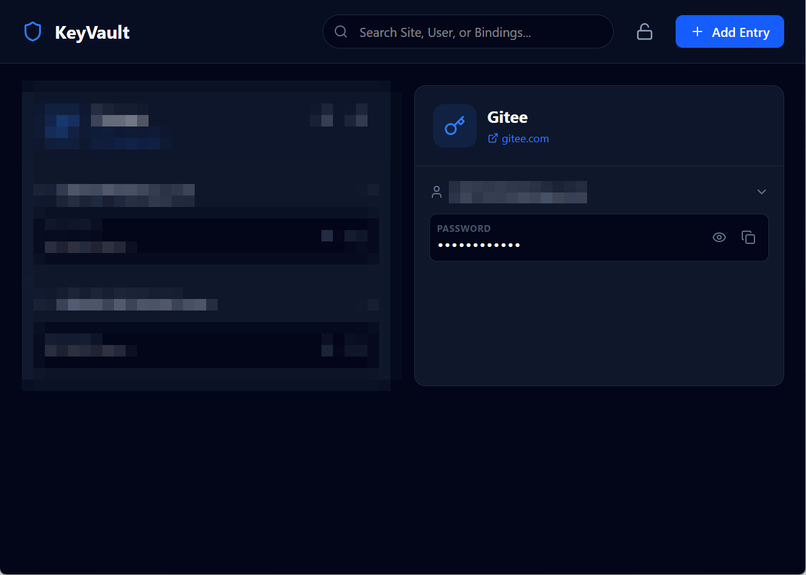
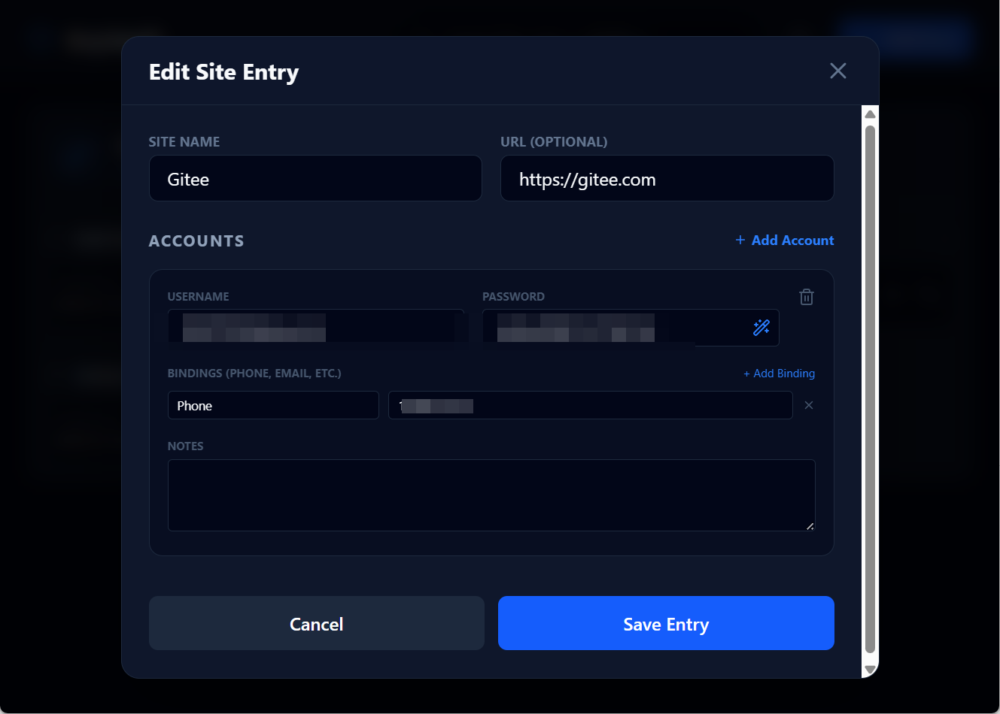
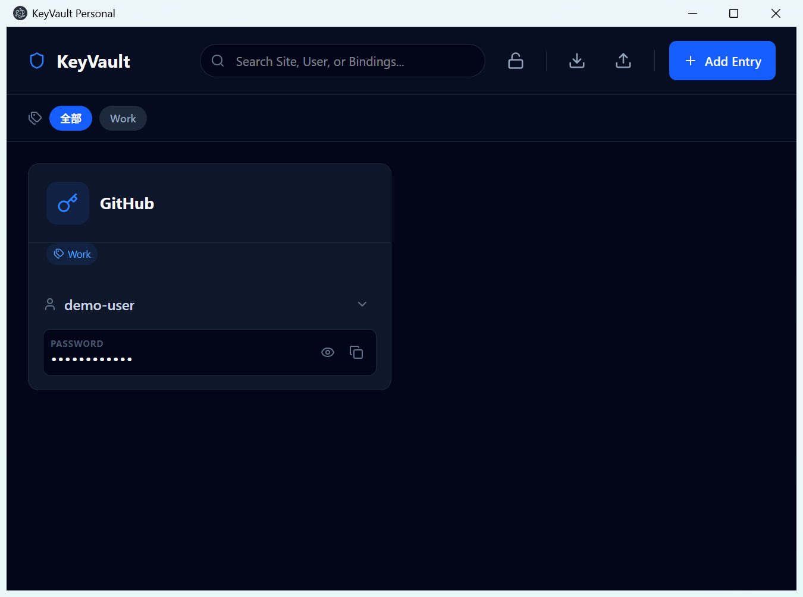
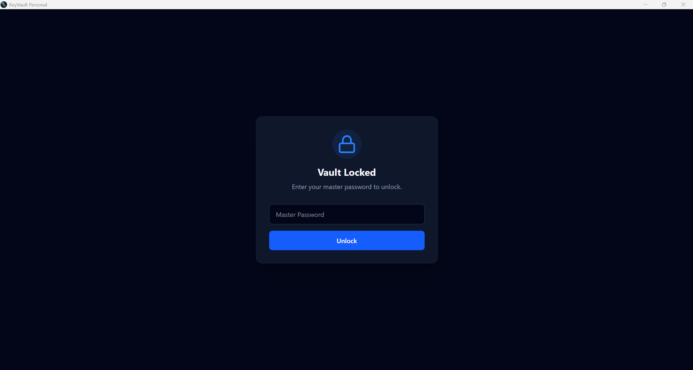

# KeyVault Personal

**A local-first, zero-knowledge password manager for personal use.**

All sensitive data is encrypted with AES-256-GCM and stored **only on your device** — no cloud, no accounts, no telemetry, no subscriptions. Your passwords stay yours.

   

## Why KeyVault Personal?

Most password managers want an account, a subscription, and your data in their cloud. KeyVault Personal takes the opposite approach: it is a **single-user, offline-first** vault designed by an engineer for personal use. Your vault file (`vault.dat`) lives on your own disk, protected by a master password that never leaves your machine — and is never stored anywhere.

If you lose the master password, the data cannot be recovered. That is by design.

## Features

- **Layered management** — a three-level model: `Site → Accounts → Bindings`. Manage multiple accounts (work / personal) under one site, with custom bindings (phone numbers, emails, recovery info) per account.
- **Zero-knowledge encryption** — keys derived with `PBKDF2-HMAC-SHA512` (100,000 iterations), data encrypted with `AES-256-GCM` (authenticated encryption).
- **Memory safety** — after unlocking, the master key lives only in memory and is **zeroized** (physically wiped) on lock or exit.
- **Penetrating search** — one search box across site names, usernames, and binding attributes.
- **Tag organization** — add up to three tags per entry, choose from existing tags or create new ones, then filter the list by tag.
- **Clipboard hygiene** — copied passwords are cleared from the system clipboard after 30 seconds.
- **Lock protection** — lock manually, or close the window; re-open always requires the master password.
- **Pure local storage** — the vault file is stored in the app data directory, with manual **export / import** (`.kvault`) for backup and cross-device migration.
- **Portable** — ships as a single portable `.exe`, no installer required.

## Security Model

| Parameter | Value |
|---|---|
| Key derivation | PBKDF2-HMAC-SHA512 |
| Iterations | 100,000 |
| Key length | 32 bytes (256-bit) |
| Symmetric cipher | AES-256-GCM |
| IV | 12 bytes |
| Salt | 16 bytes |
| File header | `[Salt 16][IV 12][AuthTag 16][Ciphertext]` |

- The master password is **never stored** — not on disk, not in memory beyond the unlock session.
- The vault file is **never** sent over the network. The app makes no telemetry, analytics, or update-phone-home calls.
- Clipboard contents self-destruct after 30 seconds.

Limits, and what this app does not protect against, are in [SECURITY.md](SECURITY.md). Closing the window locks the vault. There is still no idle timeout. This is not SM2/SM3/SM4.

## Supported platforms

| Platform | Status |
|---|---|
| Windows portable `.exe` | Supported |
| Android | Experimental — same vault format, real-device interop still open |
| macOS / Linux | Source builds only |

Back up with **Export** inside the app (`.kvault`). If the master password is lost, the vault cannot be opened.

## Screenshots






## Tech Stack

| Layer | Technology |
|---|---|
| UI | React 19 + TypeScript + Tailwind CSS 4 |
| Desktop shell | Electron 41 (electron-vite) |
| Crypto core | Shared `@keyvault/core` package (Node.js native `crypto`) |
| Mobile bridge | Capacitor 7 + custom Kotlin crypto plugin |

The encryption core is extracted into [`packages/vault-core`](packages/vault-core) so the desktop (Electron main process) and the Android app (Kotlin plugin) share the same vault format — a vault file created on desktop can be imported on Android and vice versa.

## Getting Started

### Build from source

```bash
# 1. Install dependencies
npm install

# 2. Run vault-core tests
npm test

# 3. Run in development
npm run dev

# 4. Build production bundle
npm run build

# 5. Package a portable Windows .exe
npm run package
# → dist/KeyVault Personal 1.1.0.exe
```

### Android (experimental)

> **Status: experimental.** The Capacitor shell, Kotlin crypto plugin, and shared renderer are implemented; real-device testing and cross-platform vault interop verification are still in progress. Not yet recommended as your daily driver.

```bash
cd mobile
npm run android:prepare
cd android
./gradlew.bat assembleDebug
```

See [docs/MOBILE.md](docs/MOBILE.md) and [docs/ANDROID-PACKAGING.md](docs/ANDROID-PACKAGING.md) for details.

## Vault File Location

| Platform | Path |
|---|---|
| Windows | `%APPDATA%/keyvault-personal/vault.dat` |
| macOS | `~/Library/Application Support/keyvault-personal/vault.dat` |
| Linux | `~/.config/keyvault-personal/vault.dat` |
| Android | `context.filesDir/vault.dat` |

Back up by exporting a `.kvault` file from inside the app.

## Project Structure

```
packages/vault-core/        # Shared encryption core (desktop + mobile)
src/
  main/                     # Electron main process (vault I/O, storage)
  preload/                  # Context bridge
  renderer/                 # React UI (shared with mobile build)
mobile/
  android-plugin/           # Kotlin crypto plugin (PBKDF2 + AES-GCM)
  scripts/                  # sync / plugin install helpers
docs/                       # Architecture, testing, mobile, packaging
```

## Docs

- [Architecture](docs/ARCHITECTURE.md)
- [Security limits](SECURITY.md)
- [Test plan](docs/TESTING.md)
- [Android](docs/MOBILE.md)
- [Changelog](CHANGELOG.md)
- [Roadmap](docs/ROADMAP.md)
- [Retrospective (中文)](docs/RETROSPECTIVE.zh-CN.md)

## Contributing

Issues and pull requests are welcome. This is a personal project maintained in spare time, so responses may be slow — but everything is read.

## License

[MIT](LICENSE)
