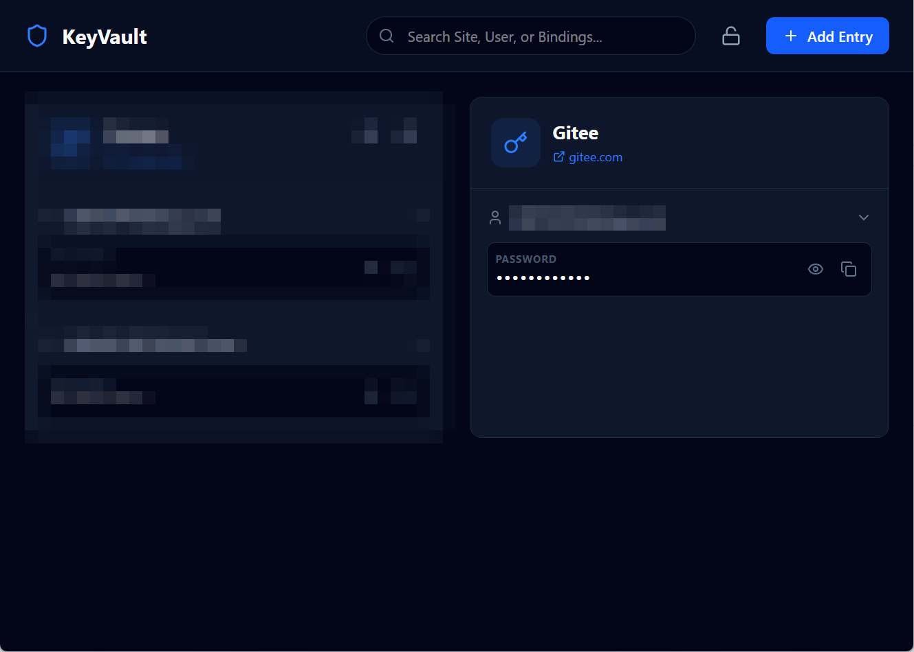
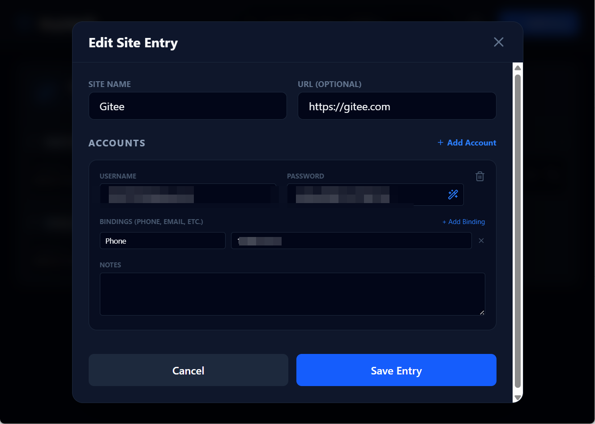

# KeyVault Personal

**一个本地优先、零知识的个人密码管理器。**

所有敏感数据均使用 AES-256-GCM 加密，并且**只保存在你自己的设备上**——无云端、无账号、无遥测、无订阅。你的密码永远属于你自己。

   

## 为什么是 KeyVault Personal？

大多数密码管理器都要你注册账号、付订阅费，并把你的数据存进它们的云。KeyVault Personal 反其道而行：它是一个**单用户、离线优先**的密码库，由一名工程师为自己使用而打造。你的保险库文件（`vault.dat`）就在你自己的磁盘上，由主密码保护——主密码从不出本机，也从不落地存储。

如果你遗失了主密码，数据将无法恢复。这是设计使然。

## 功能特性

- **分层管理** —— 三级模型：`站点 → 账号 → 绑定`。在一个站点下管理多个账号（工作 / 个人），每个账号可配置自定义绑定（手机号、邮箱、恢复信息）。
- **零知识加密** —— 密钥由 `PBKDF2-HMAC-SHA512`（100,000 次迭代）派生，数据用 `AES-256-GCM`（带认证加密）加密。
- **内存安全** —— 解锁后主密钥仅存于内存，在锁定或退出时被**清零**（物理擦除）。
- **穿透式搜索** —— 一个搜索框同时检索站点名、用户名与绑定属性。
- **剪贴板卫生** —— 复制的密码在 30 秒后自动从系统剪贴板清除。
- **锁定保护** —— 可随时手动锁定；重新打开始终需要主密码。
- **纯本地存储** —— 保险库文件存于应用数据目录，支持手动**导出 / 导入**（`.kvault`）用于备份与跨设备迁移。
- **便携** —— 以单个便携 `.exe` 发布，无需安装。

## 安全模型

| 参数 | 取值 |
|---|---|
| 密钥派生 | PBKDF2-HMAC-SHA512 |
| 迭代次数 | 100,000 |
| 密钥长度 | 32 字节（256 位） |
| 对称算法 | AES-256-GCM |
| IV | 12 字节 |
| Salt | 16 字节 |
| 文件头 | `[Salt 16][IV 12][AuthTag 16][Ciphertext]` |

- 主密码**绝不存储**——不在磁盘，也不在解锁会话之外的内存中。
- 保险库文件**从不**经网络传输。应用不做任何遥测、分析或更新回传。
- 剪贴板内容 30 秒后自毁。

做不到的部分写在 [SECURITY.md](SECURITY.md)。

## 截图




## 技术栈

| 层级 | 技术 |
|---|---|
| UI | React 19 + TypeScript + Tailwind CSS 4 |
| 桌面外壳 | Electron 41（electron-vite） |
| 加密核心 | 共享 `@keyvault/core` 包（Node.js 原生 `crypto`） |
| 移动桥接 | Capacitor 7 + 自定义 Kotlin 加密插件 |

加密核心被抽取到 [`packages/vault-core`](packages/vault-core)，使桌面端（Electron 主进程）与 Android 应用（Kotlin 插件）共享同一套保险库格式——桌面创建的保险库文件可在 Android 导入，反之亦然。

## 快速开始

### 从源码构建

```bash
# 1. 安装依赖
npm install

# 2. 开发模式运行
npm run dev

# 3. 构建生产包
npm run build

# 4. 打包便携 Windows .exe
npm run package
# → dist/KeyVault Personal 1.0.0.exe
```

### Android（实验性）

> **状态：实验性。** Capacitor 外壳、Kotlin 加密插件与共享渲染层已实现；真机测试与跨平台保险库互通验证仍在进行。尚不建议作为日常主力使用。

```bash
cd mobile
npm run android:prepare
cd android
./gradlew.bat assembleDebug
```

详见 [docs/MOBILE.md](docs/MOBILE.md) 与 [docs/ANDROID-PACKAGING.md](docs/ANDROID-PACKAGING.md)。

## 保险库文件位置

| 平台 | 路径 |
|---|---|
| Windows | `%APPDATA%/keyvault-personal/vault.dat` |
| macOS | `~/Library/Application Support/keyvault-personal/vault.dat` |
| Linux | `~/.config/keyvault-personal/vault.dat` |
| Android | `context.filesDir/vault.dat` |

备份方式：在应用内导出 `.kvault` 文件。

## 项目结构

```
packages/vault-core/        # 共享加密核心（桌面 + 移动）
src/
  main/                     # Electron 主进程（保险库 I/O、存储）
  preload/                  # 上下文桥接
  renderer/                 # React UI（与移动构建共享）
mobile/
  android-plugin/           # Kotlin 加密插件（PBKDF2 + AES-GCM）
  scripts/                  # 同步 / 插件安装辅助
docs/                       # 移动端与打包指南
```

## 参与贡献

欢迎提交 Issue 与 Pull Request。这是一个利用业余时间维护的个人项目，回复可能较慢——但每一条都会看。

## 许可证

[MIT](LICENSE)
