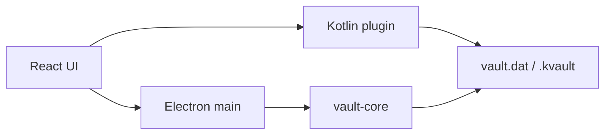

# Architecture

KeyVault Personal is a single-user, offline password manager. The desktop shell, Android shell, and React UI share one encrypted file format. There is no account service and no network path for vault data.



## Layers

| Layer | Location | Role |
|---|---|---|
| UI | `src/renderer` | React list, editor, search, tags. Shared by desktop and Android webview. |
| Desktop shell | `src/main`, `src/preload` | File dialogs, clipboard, IPC. Bundles `@keyvault/core`. |
| Mobile shell | `mobile/android-plugin` | Capacitor plugin. PBKDF2 + AES-GCM in Kotlin, same file layout. |
| Core | `packages/vault-core` | Types, KDF, AES-GCM, vault file parse/serialize, migrate, import merge. |

The renderer never sees the master key. Desktop crypto runs in the main process. Android crypto runs in the Kotlin plugin.

## Vault file

```
[Salt 16][IV 12][AuthTag 16][Ciphertext]
```

- KDF: PBKDF2-HMAC-SHA512, 100,000 iterations, 32-byte key
- Cipher: AES-256-GCM, 12-byte IV, 16-byte tag
- Payload: JSON `{ version, entries[] }`
- Export (`.kvault`) is a copy of that encrypted file, not plaintext

Desktop `vault-core` and Android `VaultCrypto.kt` must keep these numbers identical. A constant check lives in `packages/vault-core/test/vault-core.test.ts`.

## Entry model

`Site → Accounts → Bindings`, plus `tags[]` (max 3 after trim and case-insensitive dedupe). Older files without `accounts` or `tags` are migrated on load.

## Trust boundary

- Unlocked key and plaintext live in process memory.
- Renderer `sandbox` is off.
- Closing the window locks the vault.
- There is still no idle lock.
- Import decrypts with the **current** vault key. A backup from another salt or password does not merge.

Limits are listed in [SECURITY.md](../SECURITY.md). This is not a certified crypto product and it does not implement SM2/SM3/SM4.
